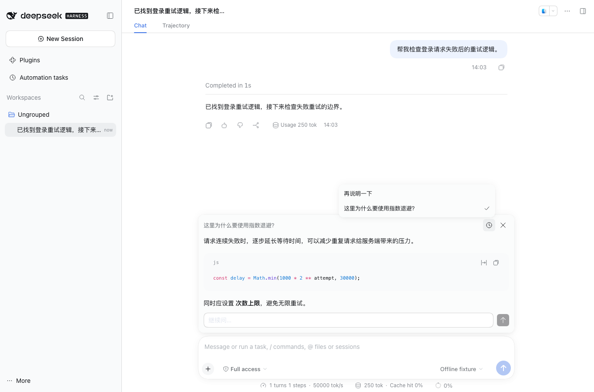

# DSH BTW

[English](README.md) | 中文

在 DeepSeek Harness 中随时问一个旁聊问题。旁聊可以读取当前对话已有的上下文，主任务继续运行，问答展示在主输入框上方的轻量弹窗中。



*展示内容为合成对话。*

## 使用

- 输入 `/btw 问题` 直接提问；输入不带问题的 `/btw` 打开弹窗、回看旁聊记录。
- 弹窗复用 DSH 原生组件，支持 Markdown、代码复制和继续提问。历史图标打开问题列表，通过 `/btw 问题` 提问时也能直接查看历史。
- **停止旁聊**只取消当前旁聊请求。**Esc** 或关闭按钮只隐藏弹窗，回答仍会继续。点击弹窗外即可返回主界面。
- 记录按主会话隔离，最多保留最近 20 条。记录仅在当前窗口内存中，刷新、关闭窗口或停用插件后消失。

旁聊保留主会话的消息前缀、上次实际请求的模型配置、工具声明及缓存关联信息，只在尾部追加旁聊内容，以复用模型服务的缓存；实际命中取决于服务端。上下文快照包括已完成的工具结果，正在生成的主回复不在快照内。已结束的历史会话也可提问。

旁聊不会执行工具，问答不会写进主对话历史。请求使用现有模型服务并产生正常用量。使用 `/btw` 前，需先在主会话发送过消息。

输入框中带附件时，`/btw` 会保留草稿并提示只接受文字，附件不会被丢弃。

## 安装

适用于 **DeepSeek Harness 0.2.1-rc.2**、**Cordis 4.0.5** 和 **Node.js 22.19+**。打开 **插件 → 添加插件**，粘贴固定版本地址：

```text
https://github.com/gulagala001/dsh-btw/releases/download/v0.1.0-dsh.0.2.1-rc.2/gulagala001-dsh-btw-0.1.0-dsh.0.2.1-rc.2.tgz
```

任务结束后重启对应实例。安装包标识为 `@gulagala001/dsh-btw`，通过 GitHub Releases 分发。

[安装指南](docs/install.zh.md) · [发行说明](docs/releases/v0.1.0-dsh.0.2.1-rc.2.md)

已在 macOS 的原生 Web 客户端验证。Windows、Linux 和 Electron 桌面外壳尚未实测。

## 开发

```sh
npm ci
npm run build
npm test
npm pack
```

前端从宿主导入 `Menu`、`MenuSurface`、`Input`、`Button`、`MarkdownText` 和 `TextShimmer`。唯一入口 `/btw` 使用原生输入扩展。后端读取只读会话快照，发起独立流式请求，不接入工具执行器。冷会话在内存中重放，不启动主 Agent。

[MIT](LICENSE)。
